# SplashCanvas Studio: Unified 3-Phase Transformation

*   **Author:** nathan
*   **Status:** Approved
*   **Date:** 2026-11-07

---

## Overview

[SplashCanvas](https://github.com/natezimm/splash-canvas) transforms digital photographs into non-photorealistic watercolor artwork directly in the browser using HTML5 2D Canvas and precomputed 64-bit Summed-Area Tables. This design document establishes a comprehensive technical blueprint spanning three decoupled milestones:

1.  **Phase 1: Watercolor Rendering Engine Realism Pass** — Physically inspired parametric heuristics, 2D boundary gradient meniscus wet-edge pooling, gravity-accelerated tapered drips with teardrop pooling reservoirs, directional satellite splatters, subtractive Beer-Lambert glazing, and procedural torn-paper deckle borders.
2.  **Phase 2: Studio Ergonomics, Standard/Advanced View & Clipboard Ingestion** — Dual-mode studio ergonomics (Standard View presenting essential artistic controls + 1-Click Smart Enhance vs. Advanced View exposing all 25 fine-grained sliders), global clipboard image paste (`Cmd+V` / `Ctrl+V`), custom preset management (`localStorage` and URL hash recipes), and direct pointer-drag pan navigation when zoomed.
3.  **Phase 3: Studio Presentation, Gallery Framing Mockup & Print Studio** — Virtual gallery wall framing mockups (Natural Oak, Gallery Black, Modern White Float via CSS containers), 1-click clipboard image export, and multi-format print sizing (PNG, high-quality JPEG at 300 DPI via hybrid resolution decomposition).

Execution follows a strict sequential implementation order: **implement Phase 1 by itself, verify it completely standalone, then implement Phase 2, then Phase 3.**

---

## The Problem

### Phase 1: Rendering Realism Deficits
*   **Scalar Alpha Darkening**: Wet water-ring darkening currently triggers across broad opacity ranges (`0.08 < alpha < 0.72`), muddying soft feathered washes instead of concentrating along true drying contact perimeters.
*   **Symmetric Splatters & Rigid Drips**: Droplets render as isolated ellipses and constant-width strokes without fluid tapering, teardrop reservoirs, or directional satellite micro-droplets.
*   **Chalky Additive Blending**: Linear alpha blending ignores the subtractive transmission absorption (Beer-Lambert law) of transparent pigments on watercolor paper.
*   **Mechanical Canvas Boundaries**: Canvas edges terminate abruptly in sharp rectangles rather than displaying the rough, fibrous deckle edge characteristic of handmade cold-press paper.

### Phase 2: Cognitive Load & Workflow Friction
*   **24-Slider Fatigue**: Presenting 24 technical parameters simultaneously overwhelms casual users seeking a quick portrait conversion. Users face decision paralysis across obscure parameters like "Hermite feather width" or "fBm perturbation amplitude".
*   **Input Ingestion Gaps**: Users cannot paste images directly from their clipboard (`Cmd+V` / `Ctrl+V`), forcing manual file saves and file picker dialogs.
*   **Stateless Preset Workflow**: Custom slider adjustments cannot be saved. Users lose custom configurations upon page refresh and cannot share parameter configurations via URLs.
*   **Zoom Navigation Constraints**: When zoomed past 1.0×, the viewport cannot be panned smoothly, preventing close-up inspection of pigment grain and Kuwahara brush strokes.

### Phase 3: Presentation & Export Limitations
*   **Lack of Tangible Presentation**: The canvas floats on a flat dark easel without physical framing context, preventing users from visualizing how the painting will appear on a gallery wall.
*   **Rigid Export Formats**: Exports are limited to raw uncompressed PNG downloads. Users cannot copy the rendered image directly to the system clipboard for messaging, nor can they export web-optimized JPEGs or verify print dimensions in inches at 300 DPI.
*   **Mobile WebKit Memory Ceilings**: Naively generating full-scale 300 DPI prints ($14\text{–}28\text{ MP}$) by computing five 64-bit Summed-Area Tables exceeds iOS Safari's 1 GB tab memory ceiling, triggering silent browser crashes.

---

## Goals

### Phase 1: Engine Realism
*   **Boundary Gradient Edge Pooling**: Restrict wet water-ring darkening to the spatial boundary gradient ($|\nabla \alpha|$) on `baseMask`, creating a crisp 1–3 px drying meniscus.
*   **Tapered Fluid Gravity Runs**: Render downward vertical paint runs that taper from origin to neck and pool into a bulbous teardrop head.
*   **Directional Satellite Splatters**: Generate trailing satellite micro-droplets along trajectory vectors and capillary starburst petals on splatter blooms.
*   **Subtractive Translucent Glazing**: Model Beer-Lambert transmission in the per-pixel compositor so paper tooth shines through pigment midtones.
*   **Configurable Deckle Edge Border**: Add a `deckleEdge` parameter ([0..100]) that erodes borders using a precomputed 1D perimeter profile modulating canvas alpha (`dst[p+3]`).
*   **Preserve Frame Rate Budget**: Maintain sub-15 ms Stage-3 rendering on 1080p source images during active slider dragging.

### Phase 2: Ergonomics & Workflow
*   **Standard View vs. Advanced View**: Provide an uncluttered Standard View presenting 6 essential controls and a 1-Click **Smart Enhance** (UI label "Magic Polish") auto-calibrator, while preserving Advanced View for all 25 fine-tuned sliders.
*   **Instant Clipboard Paste**: Support pasting images directly from the clipboard (`Cmd+V` / `Ctrl+V`) with active input guards.
*   **Custom Preset System**: Enable users to save, rename, and delete custom presets in `localStorage` and serialize parameter configurations into shareable URL hashes (`#recipe=...`).
*   **Pointer-Drag Pan Navigation**: Enable direct pointer-drag panning on `.canvas-stage` when zoomed ($> 1.0\times$), keeping `Space` reserved exclusively for "Hold to Peek Original Photo".

### Phase 3: Presentation & Print Studio
*   **Virtual Gallery Frame Mockup**: Render interactive archival mat board and frame styles (**Natural Oak**, **Gallery Black**, **Modern White Float**) via lightweight CSS container wrappers.
*   **Print Studio Modal**: Provide format selection (PNG lossless, JPEG at 92%/98%), 1-click **"Copy to Clipboard"**, and print dimension readouts in inches and centimeters at 300 DPI.
*   **Hybrid 300 DPI Export**: Upscale the memoized 1080p Stage-2 pigment buffer and execute Stage 3 natively at print resolution, preventing mobile browser memory crashes.

---

## Non-Goals

*   **Full Navier-Stokes Fluid PDE Solvers**: Eulerian grid simulations are excluded to preserve sub-15 ms CPU rendering.
*   **Backend Server Dependencies**: The application remains 100% client-side with zero npm build dependencies and zero external API dependencies.
*   **WebGL / WebGPU Migration**: Core rendering remains Canvas 2D for universal browser compatibility.
*   **Secondary Floating Loupe Canvas**: Viewport zoom ($1.0\times\text{–}2.5\times$) with direct pointer-drag pan satisfies close-up inspection without redundant offscreen render loops.
*   **Synthetic Cursive Canvas Signatures**: Precluded to avoid cross-platform system font rendering defects without bundling heavy web fonts.
*   **Combined Monolithic Implementation**: All three phases will NOT be implemented simultaneously. Phase 1 must be implemented and verified standalone before Phase 2 begins.

---

## Resolved Architectural Decisions

*   **Decision 1 (Phase 1 — Meniscus Gradient Performance)**:
    *   *Resolution*: Central differences are evaluated inline within the existing per-pixel composite loop on `baseMask`, guarded by an alpha candidate pre-filter ($0.01 < \alpha < 0.99$) and coordinate boundary clamping. Sine values are retrieved from a static 256-entry `Float32Array` LUT, adding $< 1.5\text{ ms}$ total overhead.
*   **Decision 2 (Phase 1 — Deckle Edge Export Integrity)**:
    *   *Resolution*: The deckle edge modulates strictly the destination alpha channel (`dst[p+3]`). It never writes background color `#0b0d13` into pixel data, ensuring transparent PNG exports and clean framing against off-white mats.
*   **Decision 3 (Phase 2 — Macro State Synchronization)**:
    *   *Resolution*: To eliminate state desynchronization and preserve curated preset balances, SplashCanvas avoids lossy bidirectional macro equation solvers. Instead, a Standard View toggle reveals/hides secondary technical sliders via CSS, keeping `this.params` as the clean single source of truth.
*   **Decision 4 (Phase 3 — Gallery Framing Architecture)**:
    *   *Resolution*: Studio viewport framing is handled purely via CSS containers (`.frame-oak`, `.frame-black`, `.frame-white`), preserving canvas dimensions and 1:1 brush coordinates. Procedural frame compositing is executed strictly on an offscreen canvas during export when "Include Frame" is enabled.

---

## Critical User Journeys (CUJs)

### CUJ 1: Realistic Wet-Edge and Fluid Splatter Rendering (Phase 1)
*   **Given**: An open photograph with the Bespoke Portrait preset active and `waterRingIntensity` set to 65%.
*   **When**: The user adjusts `edgeSoftness` or `washSpread` to expand the outer wash aura.
*   **Then**: The composite wash displays a sharp capillary meniscus strictly along the drying contour where the wash meets blank paper, drips taper smoothly into teardrop pooling reservoirs, and the deckle edge erodes paper borders into true transparency.

### CUJ 2: Fast 1-Click Polish via Standard View & Clipboard Paste (Phase 2)
*   **Given**: A user with an image copied to their system clipboard opens SplashCanvas in Standard View.
*   **When**: The user presses `Cmd+V` / `Ctrl+V` and clicks "Smart Enhance" (Magic Polish).
*   **Then**: The image loads immediately without opening a file dialog, contrast and wash parameters auto-calibrate based on image histograms, and the essential sliders reflect the calibrated state.

### CUJ 3: Inspecting Pigment Texture and Custom Preset Persistence (Phase 2)
*   **Given**: A user who customized parameters for pet portraits.
*   **When**: The user clicks "Save as Preset", names it "Golden Fur Watercolor", and reloads the browser tab.
*   **Then**: "Golden Fur Watercolor" persists in the preset carousel, and zooming in ($1.5\times$) with direct pointer-drag allows smooth navigation across paper grain and Kuwahara brush strokes.

### CUJ 4: Framing and Copying Wall-Ready Prints (Phase 3)
*   **Given**: A completed watercolor painting.
*   **When**: The user selects "Natural Oak Frame" in the studio toolbar and clicks "Export".
*   **Then**: The canvas renders inside an off-white beveled mat and oak frame in the viewport, the export popover displays 300 DPI dimensions in inches, and clicking "Copy Image to Clipboard" writes the framed image directly to the system clipboard.

---

## Technical Plan (Architecture)

### Architectural Overview Across 3 Phases

The architecture maintains strict decoupling: the rendering core ([`WatercolorEngine`](engine.js)) remains a pure function of parameters and image buffers, while [`SplashCanvasApp`](app.js) orchestrates DOM event delegation, UI state, presets, and export pipelines.

```mermaid
flowchart TD
    subgraph Phase1["Phase 1: Engine Realism Pass (engine.js)"]
        S1["Stage 1: SAT Tables, Edge Fields & 1D Deckle LUT"]
        S2["Stage 2: Kuwahara Base Pigment Layer (Memoized)"]
        S3["Stage 3: Compositor & Vector Splatters<br/>• Central Difference Meniscus &#124;∇α&#124;<br/>• Subtractive Beer-Lambert Glazing<br/>• Alpha-Modulated Deckle Border<br/>• Tapered Polygonal Drips & Satellites"]
        S1 --> S2 --> S3
    end

    subgraph Phase2["Phase 2: Ergonomics & Workflow (app.js & index.html)"]
        Paste["Clipboard Paste Handler (Cmd+V / Ctrl+V)"]
        ViewToggle["View Mode Toggle (Standard vs. Advanced)"]
        SmartPolish["Smart Enhance Auto-Calibrator"]
        PresetEngine["Custom Preset Engine (localStorage & Hash)"]
        StageNav["Pointer-Drag Stage Pan (zoom > 1.0)"]
    end

    subgraph Phase3["Phase 3: Presentation & Print Studio (app.js & styles.css)"]
        CSSFrames["CSS Viewport Gallery Frames (Oak, Black, White)"]
        ExportModal["Export Popover & Sizing Calculator (300 DPI)"]
        ClipExport["Async Clipboard Copy (with File Fallback)"]
        HybridPrint["Hybrid Resolution Print Pipeline"]
    end

    S3 --> ViewToggle
    ViewToggle --> CSSFrames
```



---

### Phase 1 Technical Details: Rendering Realism Pass

#### 1. Spatial Meniscus Wet-Edge Darkening
*   **Boundary Clamped Gradient Operator**: Evaluates boundary normal gradient $G(x, y) = \|\nabla \alpha\|$ directly on `baseMask` within the Stage-3 composite loop for candidate pixels ($0.01 < \alpha < 0.99$ and `waterRingStrength > 0`):
    ```javascript
    const xLeft = x > 0 ? x - 1 : 0;
    const xRight = x < w - 1 ? x + 1 : w - 1;
    const yTop = y > 0 ? y - 1 : 0;
    const yBottom = y < h - 1 ? y + 1 : h - 1;
    const gx = (baseMask[y * w + xRight] - baseMask[y * w + xLeft]) * 0.5;
    const gy = (baseMask[yBottom * w + x] - baseMask[yTop * w + x]) * 0.5;
    const G = Math.hypot(gx, gy);
    ```
*   **Capillary Ring Modulation**:
    Using a static 256-entry lookup table (`sinLUT[a] = sin(((a - 0.05) / 0.75) * PI)` for $0.05 \le a \le 0.80$):
    $$M(x, y) = \text{clamp}\left(\frac{G - 0.06}{0.28}, 0, 1\right) \cdot \text{sinLUT}[\text{round}(\alpha \cdot 255)]$$
    When $M > 0$, pigment luminance is decreased by $(1.0 - M \cdot \text{strength} \cdot 0.42)$ where $\text{strength} = \text{params.waterRingIntensity} / 100$, and saturation is boosted by $15\%$. An inward depletion halo ($G < 0.04$) brightens interior wash pigment by $(1.0 + \text{deplete} \cdot 0.06)$ where $\text{deplete} = \max(0, (0.04 - G) / 0.04) \cdot \text{strength}$.

#### 2. Tapered Fluid Gravity Runs
*   **Parametric Polygonal Width**: Drips running down lower boundaries ($n_y > 0.25, y > 0.42 H$) follow a fluid profile:
    $$w(t) = w_0 \cdot \left(1.35 \cdot (1 - t) + 0.50 \cdot \sin(\pi t) + 2.50 \cdot t^4\right)$$
    where $w_0 = \text{rng.range}(1.8, 4.2) \cdot \text{scaleFactor}$ and $t \in [0, 1]$.
*   **Polygon Construction**: Evaluates 10 segments along the spine, accumulating left and right offset vertices:
    $$\mathbf{P}_{\text{left}}(t) = \mathbf{C}(t) - \frac{w(t)}{2} \hat{\mathbf{n}}_{\perp}, \quad \mathbf{P}_{\text{right}}(t) = \mathbf{C}(t) + \frac{w(t)}{2} \hat{\mathbf{n}}_{\perp}$$
    Renders as a closed polygon contour with fluid fill, dark capillary edge stroke, and a bulbous teardrop head ($R_{\text{head}} = 1.6 \cdot w_0$) at $t = 1.0$.

#### 3. Directional Satellite Splatters & Starburst Blooms
*   **Capillary Starburst Blooms**: Splatter blooms ($R > 12\text{ px}$) perturb their radius using 24 polygon vertices and a random phase offset to prevent harmonic cancellation:
    $$r(\theta) = R \cdot (1.0 + 0.18\sin(5\theta + \phi) + 0.12\cos(9\theta))$$
*   **Satellite Spray**: Droplets ($R > 2.8 \cdot \text{scaleFactor}$) project 1 to 3 trailing micro-droplets along their trajectory vector at distances $d_k = \text{dist} + R \cdot (2.2k + \text{rand}(0.5, 1.5))$ with radii $R_k = R \cdot 0.35^k$.

#### 4. Subtractive Beer-Lambert Glazing & Chromatic Granulation
*   **Subtractive Midtone Glaze**: Applies midtone transmission absorption immediately before final composite without double-counting paper background:
    $$\mathbf{C}_{\text{glaze}} = (\mathbf{C}_{\text{paper}} \odot \mathbf{C}_{\text{fg}}) / 255$$
    Blended via $\text{glazeMix} = \text{clamp}((1.0 - \text{coreWeight} \cdot 0.6) \cdot 0.55, 0, 0.60)$.
*   **Chromatic Granulation**: Settles pigment into paper valleys ($paperVal < 0.48$), applying cool mineral undertones scaled by granulation depth:
    $$\Delta B = +(0.48 - \text{paperVal}) \cdot \text{granulation} \cdot 7.0, \quad \Delta R = -(0.48 - \text{paperVal}) \cdot \text{granulation} \cdot 4.0$$

#### 5. Procedural Torn-Paper Deckle Edge Border
*   **Parameter**: `deckleEdge` [0..100] in `@typedef {WatercolorParams}`.
*   **Stage 1 Precomputation**: In `_buildPaperAndCloudFields()`, precompute 1D perimeter perturbation profiles of length $W$ and $H$ using 3-octave Perlin fBm.
*   **Stage 3 Alpha Modulation**:
    - Fast bounding-box guard: $D_{\max} = \text{round}((\text{deckleEdge} / 100) \cdot 24 \cdot \text{scaleFactor})$. If $x \ge D_{\max}$ and $x < W - D_{\max}$ and $y \ge D_{\max}$ and $y < H - D_{\max}$, skip deckle calculation ($O(1)$ pass-through).
    - For boundary pixels, lookup threshold $\tau = D_{\max} \cdot \text{perimeterLUT}[i]$. Distance to edge $d = \min(x, W - 1 - x, y, H - 1 - y)$.
    - Modulate destination alpha:
      $$\text{dst}[p + 3] = \text{round}\left(\text{dst}[p + 3] \cdot \text{clamp}\left(\frac{d - \tau + 1.5}{1.5}, 0, 1\right)\right)$$
      Zero RGB canvas pollution; outer sheet fades into true transparency.

---

### Phase 2 Technical Details: Ergonomics, Standard View & Clipboard Ingestion

#### 1. Dual-Mode Studio Ergonomics (Standard View vs. Advanced View)
*   **Architecture**: `SplashCanvasApp` maintains `this.viewMode = 'standard' | 'advanced'` persisted in `localStorage`.
*   **Standard View**: Exposes 6 high-impact artistic controls (*Brush Size*, *Wash Spread*, *Color Bleed*, *Splatter Amount*, *Pencil Sketch*, *Deckle Edge*) plus paper palette buttons and preset cards. Secondary technical controls (Hermite feathering, Kuwahara sector count, Sobel thresholds) are cleanly hidden via CSS (`.control-row.advanced { display: none; }`).
*   **Advanced View**: Reveals all 25 fine-grained sliders partitioned into the existing 6 collapsible accordions with search and reset capabilities.
*   **1-Click Smart Enhance ("Magic Polish")**: Samples ~20,000 pixels with uniform stride from `engine.srcData`. Computes mean saturation and dynamic luminance range to auto-calibrate `vibrancy`, `contrast`, `luminosity`, and `subjectCoverage` without developer guesswork.

#### 2. Global Clipboard Paste (`Cmd+V` / `Ctrl+V`)
*   **Event Listener**: Attached to `window` with an active input focus guard (`["INPUT", "TEXTAREA"].includes(document.activeElement?.tagName)`).
*   **Extraction**: Iterates over `e.clipboardData.items`. Detects `type.startsWith('image/')`, extracts the `File` object via `item.getAsFile()`, and passes it directly to `this.loadUserFile(file)`.

#### 3. Custom Preset Management & URL Hash Recipes
*   **Storage**: Custom presets stored in `localStorage['splashcanvas_custom_presets']`.
*   **Preset Registry**: `SplashCanvasApp` maintains `this.customPresets = []` and a merged getter `getAllPresets() => [...PRESETS, ...this.customPresets]` to prevent mutating the frozen `PRESETS` array.
*   **URL Sharing**: Serializes the 25 parameter values into a compressed URL hash string (`#recipe=...`), validated against a numeric bounds whitelist on page load.

#### 4. Pointer-Drag Pan Navigation
*   **Stage Pan**: When `this.zoom > 1.0` and `this.brushMode === 'none'`, dragging the mouse on `.canvas-stage` translates the canvas container smoothly via CSS transforms (`translate(panX, panY)`).
*   **Comparison Invariant**: `Space` remains reserved strictly for "Hold to Peek Original Photo" ([`app.js`](app.js)).

---

### Phase 3 Technical Details: Presentation & Print Studio

#### 1. Virtual Gallery Frame Mockup
*   **Frame Styles**:
    *   `none`: Unframed raw canvas.
    *   `oak`: Scandinavian natural oak moulding (`#b58d59`, 24px border, dual bevel shadows).
    *   `black`: Minimalist gallery black wood (`#1a1a1a`, 20px border, deep shadow).
    *   `white`: Modern floating white gallery frame (`#f0ede6`, 24px border, subtle outer wash shadow).
*   **Mat Board Geometry**: 36px off-white archival mat (`#fbfaf7`) with an inner 45-degree beveled shadow (`box-shadow: inset 0 2px 6px rgba(0, 0, 0, 0.35)`).
*   **Implementation**: Applied purely as CSS classes on `#canvas-container` (`.frame-oak`, etc.) during interactive studio preview, avoiding canvas coordinate offset bugs.

#### 2. Print Studio Export Popover & Pipeline
*   **UI Container**: An accessible export popover anchored to `#export-btn` in the header:
    - Format selector: PNG (lossless) or JPEG (quality options: 92% / 98%).
    - "Include Gallery Frame" checkbox.
    - 300 DPI print dimension readouts in inches and centimeters:
      $$\text{Width (in)} = \frac{W_{\text{px}}}{300}, \quad \text{Height (in)} = \frac{H_{\text{px}}}{300}$$
    - Action buttons: `<button id="do-download-btn">Download Image</button>` and `<button id="copy-clipboard-btn">Copy to Clipboard</button>`.
*   **Direct Clipboard Copy**: Calls modern promise constructor `navigator.clipboard.write([new ClipboardItem({ 'image/png': blobPromise })])`. Falls back gracefully to file download if clipboard permissions fail.
*   **Hybrid Resolution Upscaling**:
    To eliminate mobile WebKit memory crashes on 300 DPI prints, the exporter:
    1. Upscales the memoized 1080p Stage-2 base pigment buffer using bicubic canvas interpolation (~55 MB at 14 MP).
    2. Runs Stage 3 (paper tooth, granulation, wet meniscus, and vector splatters/drips) natively at print resolution.
    3. If "Include Frame" is checked, renders the mat board and frame moulding onto an enlarged offscreen canvas.

---

## Alternatives Considered

### Phase 1 Alternatives (Rendering Realism)

#### Alternative 1.1: Full Eulerian Grid-Based Navier-Stokes Fluid Simulation
*   **Pros**: Organic pigment dispersion along velocity vectors.
*   **Cons**: CPU execution scales to 150–400 ms per frame, dropping slider rates to 2–5 FPS. WebGL compute shaders introduce driver fragmentation and context loss.
*   **Rejection Rationale**: Canvas 2D CPU budget cannot sustain interactive 60 FPS slider scrubbing under full fluid PDE integration. Closed-form parametric formulations provide equivalent visual realism in under 15 ms with zero external dependencies.

#### Alternative 1.2: Pre-Allocated 2D Boundary Gradient Buffer Pass
*   **Pros**: Computes gradient magnitudes in a dedicated pass.
*   **Cons**: Requires allocating an additional full-resolution `Float32Array(W * H)` (4.5 MB at 1080p), triggering GC pauses during 60 FPS scrubbing.
*   **Rejection Rationale**: Inline 4-tap central difference sampling on `baseMask` within the existing compositing loop avoids heap allocations, operates entirely within CPU cache, and adds $< 1.5\text{ ms}$ overhead.

#### Alternative 1.3: DOM / CSS Mask-Based Deckle Edge Framing
*   **Pros**: Zero canvas pixel computations; delegated entirely to the browser GPU.
*   **Cons**: CSS masks alter only the screen presentation in the viewport. Exported PNG files capture raw rectangular pixels, omitting the torn-paper edge.
*   **Rejection Rationale**: Export integrity requires downloaded prints to reflect the visible artwork. Modulating the alpha channel inside the Stage-3 pixel pipeline ensures identical results across viewport and print exports.

---

### Phase 2 Alternatives (Ergonomics & Workflow)

#### Alternative 2.1: Coupled Continuous Macro Slider Engine
*   **Pros**: Collapses 25 sliders into 5 macro inputs.
*   **Cons**: Linear and ratio-based equations destroy curated asymmetric preset balances and cause state desynchronization when switching between modes.
*   **Rejection Rationale**: A Standard vs. Advanced View Mode toggle provides immediate simplicity for casual users while preserving 100% parameter fidelity and zero state-sync complexity.

#### Alternative 2.2: Cloud / Backend Database for Custom Preset Sharing
*   **Pros**: Searchable user preset gallery.
*   **Cons**: Violates zero-dependency static rules, requires authentication, and introduces server infrastructure costs.
*   **Rejection Rationale**: `localStorage` combined with URL hash recipes (`#recipe=...`) achieves 100% offline-first portability with zero backend overhead.

---

### Phase 3 Alternatives (Presentation & Export)

#### Alternative 3.1: Live Canvas-Baked Gallery Framing
*   **Pros**: Draws wooden moulding and mat bevels directly inside `engine.render()`.
*   **Cons**: Mutates canvas aspect ratios, repaints heavy frames at 60 FPS, and breaks 1:1 brush mask coordinates.
*   **Rejection Rationale**: CSS container wrappers handle viewport presentation with zero CPU overhead. Procedural canvas framing is quarantined exclusively to `exportArtwork()`.

#### Alternative 3.2: SVG / Web Font Vector Signature Layer
*   **Pros**: Crisp vector typography.
*   **Cons**: Cross-platform system cursive fonts look inconsistent and unconvincing without bundling 200 KB web fonts, violating zero-dependency static guidelines. Fine-art prints are signed by hand.
*   **Rejection Rationale**: De-scoped to focus engineering investment on rendering realism and studio ergonomics.

---

## Non-Functional Requirements

### Performance & Latency Budget
*   **Stage-3 Interactive Execution**: Total Stage-3 frame execution (mask generation, inline gradient meniscus, subtractive glazing, granulation, deckle edge, and vector splatters/drips) must not exceed 15 ms on a 1.2-megapixel canvas ($900 \times 1200$), maintaining 60 FPS responsiveness during active slider dragging.
*   **Zero Heap Allocation in Inner Loops**: The per-pixel compositing loop must not allocate objects, closures, or temporary arrays. All calculations must use scalar primitives and direct typed-array indexing.
*   **Stage-2 Kuwahara Cache Invariance**: In accordance with the project architecture invariants, modifying `deckleEdge`, `waterRingIntensity`, `splatterAmount`, or `dripLength` must yield a cache hit on `this.lastPaintSignature`, bypassing the Kuwahara filter pass.

### Compatibility & Reliability
*   **100% Static & Client-Side**: No WebGL context dependencies, Web Workers, or external libraries. Must run identically on standard HTML5 2D Canvas across desktop and mobile Safari, Chrome, Firefox, and Edge.
*   **Deterministic Reproducibility**: Given the same PRNG seed and parameter set, splatters, drips, paper tooth, and deckle edges must render with bit-exact parity across native preview (1x) and print export resolutions.
*   **Async Clipboard API Graceful Fallback**: When copying rendered artwork to the clipboard, if `navigator.clipboard.write` fails or is blocked by browser permissions, automatically fall back to downloading the file and notify the user via studio toast.

### Security & Privacy Considerations
*   **Clipboard & File Boundary**: The global clipboard paste handler must validate MIME types (`image/png`, `image/jpeg`, `image/webp`) before processing. Non-image clipboard payloads must be discarded immediately without disk writes or network requests.
*   **Zero Remote Telemetry**: Custom preset serialization and image processing must remain 100% local; no image data or parameter hashes may be transmitted to external servers.
*   **URL Hash Sanitization**: When parsing URL hash recipes (`#recipe=...`), all parameters must be validated against a strict numeric whitelist and clamped to their defined ranges (`[min, max]`) to prevent prototype pollution or invalid state.
*   **CORS & Tainted Canvas Protection**: Remote sample images must specify `crossOrigin = "anonymous"` from CORS-enabled hosts (`images.unsplash.com`) with immediate fallback to procedural generation to ensure `ctx.getImageData()` and `canvas.toBlob()` never throw security errors.

### Accessibility (a11y) & UX Invariants
*   **Keyboard Operability**: All new controls, preset cards, view toggle buttons, and export popover fields must support standard Tab stops, Enter/Space activation, and arrow key navigation.
*   **Live Region Feedback**: Preset updates, clipboard paste events, and export actions must announce status via the ARIA live toast container (`#studio-toast`).

---

## Detailed Implementation Plan

The implementation is partitioned into three decoupled, sequentially executed milestones:

```text
Milestone 1 (Engine Realism)  -->  Verify Standalone & Commit
        ↓
Milestone 2 (Ergonomics & Standard View)  -->  Verify Standalone & Commit
        ↓
Milestone 3 (Framing & Print Studio)  -->  Verify Standalone & Commit
```

---

### File Inventory Across All Milestones

```text
splash-canvas/
├── engine.js       (M1: Spatial meniscus, tapered drips, satellite splatters, glaze, alpha deckle)
├── app.js          (M1: deckleEdge parameter; M2: Standard View, paste, presets, pan; M3: CSS framing, export popover)
├── index.html      (M1: deckle slider; M2: Standard View toggle; M3: frame picker, export popover)
├── styles.css      (M2: Standard View hiding rules, toast updates; M3: CSS gallery frame styles)
├── README.md       (M1, M2, M3: Documentation updates)
└── AGENTS.md       (M1, M2, M3: Architecture guidelines update)
```

---

### Milestone 1: Engine Realism Pass (Stand-Alone Implementation)

#### 1. [`engine.js`](engine.js) (Modify)
*   **Type / Scope**: Core Rendering Engine (`WatercolorEngine`)
*   **Rationale**: Implement fluid heuristics and optical approximations in Stage 3 compositing and vector splatter passes without altering Stage 1 or Stage 2 memoization.
*   **Proposed Changes**:
    1.  **JSDoc Schema**:
        *   Update `@typedef {Object} WatercolorParams` to add `@property {number} deckleEdge - Procedural torn-paper border width [0..100]`.
    2.  **Lookup Table Precomputation (`constructor`)**:
        *   Precompute a static 256-entry sine lookup table for the contact line:
            ```javascript
            this.sinLUT = new Float32Array(256);
            for (let i = 0; i < 256; i++) {
              const a = i / 255;
              this.sinLUT[i] = (a >= 0.05 && a <= 0.80)
                ? Math.sin(((a - 0.05) / 0.75) * Math.PI)
                : 0;
            }
            ```
    3.  **1D Perimeter Deckle Profile (`_buildPaperAndCloudFields()`)**:
        *   Precompute 1D boundary displacement arrays of size $W$ and $H$ using 3-octave Perlin fBm:
            ```javascript
            this.deckleTop = new Float32Array(w);
            this.deckleBottom = new Float32Array(w);
            this.deckleLeft = new Float32Array(h);
            this.deckleRight = new Float32Array(h);
            for (let x = 0; x < w; x++) {
              this.deckleTop[x] = 0.55 + 0.60 * this.noise2D.fBm(x / 14, 0, 3, 0.5, 2.0);
              this.deckleBottom[x] = 0.55 + 0.60 * this.noise2D.fBm(x / 14, 1, 3, 0.5, 2.0);
            }
            for (let y = 0; y < h; y++) {
              this.deckleLeft[y] = 0.55 + 0.60 * this.noise2D.fBm(0, y / 14, 3, 0.5, 2.0);
              this.deckleRight[y] = 0.55 + 0.60 * this.noise2D.fBm(1, y / 14, 3, 0.5, 2.0);
            }
            ```
    4.  **Spatial Meniscus Wet-Edge Darkening (`render()`)**:
        *   Replace scalar alpha checking with boundary-clamped central differences for candidate pixels ($0.01 < \alpha < 0.99$ and `waterRingStrength > 0`):
            ```javascript
            const xLeft = x > 0 ? x - 1 : 0;
            const xRight = x < w - 1 ? x + 1 : w - 1;
            const yTop = y > 0 ? y - 1 : 0;
            const yBottom = y < h - 1 ? y + 1 : h - 1;
            const gx = (baseMask[y * w + xRight] - baseMask[y * w + xLeft]) * 0.5;
            const gy = (baseMask[yBottom * w + x] - baseMask[yTop * w + x]) * 0.5;
            const G = Math.hypot(gx, gy);

            if (G > 0.06) {
              const gradFactor = Math.min(1, (G - 0.06) / 0.28);
              const ringBell = this.sinLUT[Math.round(alpha * 255)];
              const M = gradFactor * ringBell;
              if (M > 0) {
                const darken = 1.0 - M * waterRingStrength * 0.42;
                fgR *= darken; fgG *= darken; fgB *= darken;
                const gray = 0.299 * fgR + 0.587 * fgG + 0.114 * fgB;
                const chroma = 1.0 + 0.15 * M;
                fgR = Math.max(0, Math.min(255, gray + (fgR - gray) * chroma));
                fgG = Math.max(0, Math.min(255, gray + (fgG - gray) * chroma));
                fgB = Math.max(0, Math.min(255, gray + (fgB - gray) * chroma));
              }
            } else if (G < 0.04 && alpha > 0.05 && alpha < 0.70) {
              const deplete = (1.0 - G / 0.04) * waterRingStrength;
              const depleteFactor = 1.0 + deplete * 0.06;
              fgR = Math.min(255, fgR * depleteFactor);
              fgG = Math.min(255, fgG * depleteFactor);
              fgB = Math.min(255, fgB * depleteFactor);
            }
            ```
    5.  **Subtractive Translucent Glaze Blending (`render()`)**:
        *   Apply midtone pigment transmission glaze immediately before final composite:
            ```javascript
            const glazeMix = Math.max(0, Math.min(0.60, (1.0 - coreWeight * 0.6) * 0.55));
            if (glazeMix > 0) {
              fgR = fgR * (1 - glazeMix) + ((paperRGB[0] * fgR) / 255) * glazeMix;
              fgG = fgG * (1 - glazeMix) + ((paperRGB[1] * fgG) / 255) * glazeMix;
              fgB = fgB * (1 - glazeMix) + ((paperRGB[2] * fgB) / 255) * glazeMix;
            }
            ```
    6.  **Chromatic Mineral Granulation (`render()`)**:
        *   Incorporate cool mineral undertones in paper valleys:
            ```javascript
            if (granulation > 0 && alpha > 0.02 && paperVal < 0.48) {
              const valleyDepth = (0.48 - paperVal) * granulation * 2.0;
              fgB = Math.min(255, fgB + valleyDepth * 3.5);
              fgR = Math.max(0, fgR - valleyDepth * 2.0);
            }
            ```
    7.  **Procedural Deckle Edge Border (`render()`)**:
        *   Modulate destination alpha with zero RGB canvas pollution:
            ```javascript
            const maxDeckle = Math.round((params.deckleEdge / 100) * 24 * scaleFactor);
            if (maxDeckle > 0) {
              const d = Math.min(x, w - 1 - x, y, h - 1 - y);
              if (d < maxDeckle * 1.15) {
                const tau = maxDeckle * Math.min(
                  this.deckleTop[x], this.deckleBottom[x],
                  this.deckleLeft[y], this.deckleRight[y]
                );
                if (d < tau) {
                  const factor = Math.max(0, Math.min(1, (d - tau + 1.5) / 1.5));
                  dst[p + 3] = Math.round(dst[p + 3] * factor);
                }
              }
            }
            ```
    8.  **Tapered Fluid Gravity Runs (`_renderSplattersAndDrips()`)**:
        *   Construct closed polygonal contour with lateral offset points, rounded endcaps, and bulbous teardrop terminal heads.
    9.  **Directional Satellite Splatters & Capillary Blooms (`_renderSplattersAndDrips()`)**:
        *   Increase `_drawOrganicSplatterBlob()` vertices to 24 with random phase offset to avoid harmonic aliasing.
        *   Project 1–3 satellite micro-droplets along trajectory vectors.

#### 2. [`app.js`](app.js) (Modify)
*   **Type / Scope**: Studio Controller & State Management (`SplashCanvasApp`, `PRESETS`)
*   **Proposed Changes**:
    *   Add `deckleEdge` to all 8 preset configurations in `PRESETS` (`fiverr-classic`: 45, `cloud-storybook`: 50, `ink-and-wash`: 40, `expressive-splash`: 65, `dreamy-pastel`: 55, `dry-brush-atelier`: 70, `full-scene-aquarelle`: 35, `botanical-vintage`: 60).
    *   Ensure `_syncUIFromParams()` updates `#Ctrl-deckleEdge` and range track fill `--fill-pct`.

#### 3. [`index.html`](index.html) (Modify)
*   **Type / Scope**: Studio UI Markup
*   **Proposed Changes**:
    *   Insert `.control-row` with `data-label="deckle torn paper border edge archival"` inside `<details class="control-group" data-group="paper">` for `#Ctrl-deckleEdge`.
    *   Update slider count labels from `24` to `25` (`All (25)`, `Search 25 sliders...`).

---

### Milestone 2: Studio Ergonomics, Standard View & Clipboard Ingestion

#### 1. [`index.html`](index.html) (Modify)
*   **Proposed Changes**:
    *   Add view mode toggle button in `.sliders-header`: `<button id="view-mode-toggle" class="btn-subtle">Advanced View</button>`.
    *   Mark secondary technical slider rows with class `advanced`.
    *   Add a prominent "Smart Enhance" (Magic Polish) button in the top studio bar.
    *   Add "Save Custom Preset" button and modal dialog for user-saved styles.

#### 2. [`app.js`](app.js) (Modify)
*   **Proposed Changes**:
    *   **Clipboard Paste Handler**: Bind `window.addEventListener('paste', ...)` with active input focus guard (`["INPUT", "TEXTAREA"].includes(document.activeElement?.tagName)`).
    *   **View Mode Controller**: Toggle `this.viewMode` between `'standard'` and `'advanced'`, updating the DOM body class (`.mode-standard` / `.mode-advanced`).
    *   **Smart Enhance Algorithm**: Sample ~20,000 pixels with uniform stride from `engine.srcData`. Compute saturation and luminance range to auto-set `vibrancy`, `contrast`, `luminosity`, and `subjectCoverage`.
    *   **Custom Preset Engine**: Maintain `this.customPresets = []` in `localStorage['splashcanvas_custom_presets']` and provide merged getter `getAllPresets() => [...PRESETS, ...this.customPresets]`.
    *   **Pointer-Drag Stage Pan**: Translate `.canvas-stage` on mouse drag when `this.zoom > 1.0` and `this.brushMode === 'none'`. Spacebar remains strictly reserved for "Hold to Peek".

#### 3. [`styles.css`](styles.css) (Modify)
*   **Proposed Changes**:
    *   CSS rules hiding advanced rows in Standard View: `.mode-standard .control-row.advanced { display: none; }`.

---

### Milestone 3: Presentation, Gallery Framing & Print Studio

#### 1. [`index.html`](index.html) (Modify)
*   **Proposed Changes**:
    *   Add Gallery Frame select (`None`, `Natural Oak`, `Gallery Black`, `White Float`) in `.stage-right-tools`.
    *   Add `<div class="modal-backdrop hidden" id="export-modal">` containing JPEG quality controls, 300 DPI sizing readouts, "Include Frame" checkbox, and `<button id="copy-clipboard-btn">Copy to Clipboard</button>`.

#### 2. [`app.js`](app.js) (Modify)
*   **Proposed Changes**:
    *   **CSS Viewport Framing**: Apply selected frame style as CSS class on `#canvas-container` (`.frame-none`, `.frame-oak`, `.frame-black`, `.frame-white`).
    *   **Direct Clipboard Copy**: Implement `copyArtworkToClipboard()` using `navigator.clipboard.write([new ClipboardItem({ 'image/png': blobPromise })])` with graceful fallback to file download.
    *   **Hybrid 300 DPI Export**: Upscale memoized Stage-2 base pigment buffer and execute Stage 3 natively at print resolution. If "Include Frame" is enabled, composite frame moulding and beveled mat onto the offscreen export canvas.

#### 3. [`styles.css`](styles.css) (Modify)
*   **Proposed Changes**:
    *   CSS styling for `.frame-oak`, `.frame-black`, and `.frame-white` on `#canvas-container`.
    *   Modal styling for `#export-modal`.

---

## Verification Plan Across All Milestones

### Milestone 1 Verification (Engine Realism)
1.  **Node Syntax**: `node --check engine.js && node --check app.js`.
2.  **Deterministic Invariant Verification**: Confirm identical PRNG outputs across repeated renders and verify Stage-2 cache hits when adjusting `deckleEdge`, `waterRingIntensity`, `splatterAmount`, or `dripLength`.
3.  **Frame Execution Telemetry**: Run automated browser console test asserting Stage-3 frame execution is $< 15\text{ ms}$ on a 1080p canvas:
    ```javascript
    console.assert(window.app.engine.lastCacheHit === false, "Initial render must be full pass");
    const t0 = performance.now();
    window.app.params.deckleEdge = 60;
    window.app.engine.render(window.app.outputCanvas, window.app.params);
    const elapsed = performance.now() - t0;
    console.assert(window.app.engine.lastCacheHit === true, "deckleEdge must hit Stage-2 Kuwahara cache");
    console.assert(elapsed < 15, `Stage 3 render took ${elapsed.toFixed(1)}ms (must be < 15ms)`);
    ```
4.  **Alpha Transparency Check**: Export a PNG with `deckleEdge > 0` and assert that pixels at $(0, 0)$ have `alpha === 0`.
5.  **Visual Smoke Test**: Verify boundary meniscus rings without mid-wash darkening, tapered drips with teardrop heads, directional satellite splatters, and organic torn-paper deckle borders.

### Milestone 2 Verification (Ergonomics & Standard View)
1.  **Clipboard Paste**: Copy an image to the clipboard, press `Cmd+V` / `Ctrl+V`, and verify the canvas loads immediately without opening a file picker.
2.  **Standard vs. Advanced View**: Toggle between Standard and Advanced views; confirm that secondary sliders hide cleanly without parameter loss or layout shift.
3.  **1-Click Smart Enhance**: Load a low-contrast image, click "Smart Enhance", and verify automatic contrast and vibrancy calibration.
4.  **Preset Persistence**: Save a custom preset, reload the page, and verify the custom preset persists and applies cleanly.
5.  **Pointer-Drag Pan**: Zoom to $1.5\times$, drag the mouse to pan across the canvas, and confirm that holding `Space` still triggers "Hold to Peek Original Photo".

### Milestone 3 Verification (Framing & Print Studio)
1.  **Gallery Framing**: Toggle Oak, Black, and White frames; verify beveled mat board borders and drop shadows in the viewport.
2.  **Clipboard Copy**: Click "Copy to Clipboard", paste into an external graphics app or chat, and verify the image copies cleanly.
3.  **Print Dimensions**: Check export readout at 1x, 1.5x, 2x scale; verify accurate inch/cm calculations at 300 DPI.
4.  **Hybrid Export Memory Safety**: Trigger a 300 DPI export on mobile Safari or simulated mobile viewport; assert that export completes successfully without tab crash.
