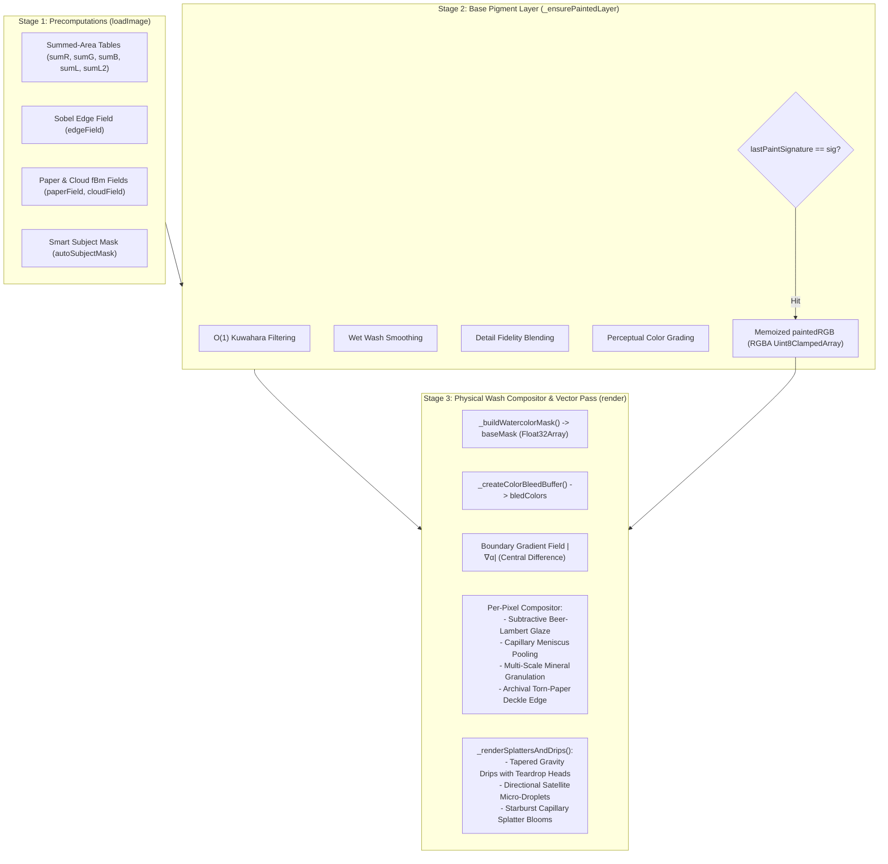

# Watercolor Rendering Engine Realism Pass

*   **Author:** nathan
*   **Status:** Approved
*   **Date:** 2026-11-07

--------------------------------------------------------------------------------

## Overview

SplashCanvas transforms digital photographs into non-photorealistic watercolor artwork directly in the browser using HTML5 2D Canvas and precomputed 64-bit Summed-Area Tables. While the existing pipeline achieves interactive frame rates (<15 ms per frame), the visual output contains digital artifacts that distinguish it from authentic physical watercolor painting: scalar alpha darkening around masks, uniform mechanical spatter dots, rigid constant-width drips, flat brightness scaling for pigment settling, and synthetic straight canvas boundaries.

This feature updates the core rendering engine in `engine.js` with physical fluid mechanics and optical pigment behaviors: 2D spatial meniscus wet-edge pooling, gravity-accelerated fluid drips with teardrop pooling heads, directional satellite spatter sprays, multi-scale pigment sedimentation with chromatic separation, subtractive translucent glazing, and organic torn-paper deckle borders.

--------------------------------------------------------------------------------

## The Problem

The current rendering algorithms approximate watercolor phenomena using computationally inexpensive 1D shortcuts rather than 2D spatial and fluid physics:

1.  **Scalar Alpha Darkening**: The engine simulates wet water-ring edge pooling by checking if scalar opacity satisfies `0.08 < alpha < 0.72`. If a portrait features an extended soft-focus background or smooth feathering where opacity remains in this interval across dozens of pixels, the entire area is darkened. Real capillary flow only deposits pigment at the drying contact perimeter where opacity gradients are steep.
2.  **Symmetric Splatters and Droplets**: Splatters are rendered as 10-vertex radial gradient polygons, while droplets are drawn as isolated ellipses. Physical splatters ejected from a brush display high-velocity satellite micro-droplets aligned along ballistic trajectory vectors, as well as capillary starburst lobes radiating into paper fibers.
3.  **Rigid Gravity Drips**: Drips are drawn as segmented lines of constant stroke width terminated by a simple circle. Real liquid paint runs accelerate under gravity, taper in width along the path, and accumulate at the leading deceleration head into a suspended teardrop reservoir.
4.  **Monochrome Granulation**: Pigment granulation multiplies RGB channels by a uniform scalar derived from the paper heightmap (`fgR *= settle`). In reality, heavy mineral pigments (e.g., ultramarine or burnt umber) settle into microscopic paper crevices as distinct granulating particles, while lighter transparent dyes remain in the wash, creating localized tonal and chromatic contrast.
5.  **Additive vs. Subtractive Wash Blending**: The compositor combines pigment and paper using standard digital alpha blending (`bg * (1 - alpha) + fg * alpha`). True watercolor is a translucent subtractive glaze where incident light penetrates pigment, reflects off white cellulose fibers, and filters back out.
6.  **Hard Digital Canvas Boundaries**: The artwork terminates abruptly at canvas boundaries. Fine-art watercolor papers (such as Arches or Fabriano cold-press) feature irregular, fibrous deckle edges that provide tactile framing.

--------------------------------------------------------------------------------

## Goals

*   **Boundary Gradient Edge Pooling**: Restrict wet water-ring darkening to the spatial boundary gradient ($|\nabla \alpha|$) of the composite wash mask, producing a crisp 1–3 px drying meniscus without darkening broad mid-tone wash areas.
*   **Tapered Fluid Gravity Runs**: Render downward vertical paint runs that taper from origin to mid-stream and form a teardrop accumulation head at the termination point.
*   **Ballistic Satellite Splatters**: Generate directional satellite micro-droplets along splatter trajectory vectors and multi-frequency capillary petal perimeters.
*   **Chromatic Pigment Sedimentation**: Separate granulation into paper valley sediment with localized chromatic contrast rather than uniform channel darkening.
*   **Subtractive Translucent Glazing**: Model Beer-Lambert transmission in the per-pixel compositor so paper tooth and tint reflect through transparent washes.
*   **Configurable Deckle Edge Border**: Add a `deckleEdge` parameter ([0..100]) that introduces procedural torn-paper boundary perturbation to canvas borders without invalidating Stage-2 pigment cache.
*   **Preserve Frame Rate Budget**: Maintain sub-20 ms rendering on 1080p source images during Stage-3 updates.

--------------------------------------------------------------------------------

## Non-Goals

*   **Navier-Stokes Fluid Simulation**: Solving full 2D grid-based Navier-Stokes fluid dynamics or Eulerian shallow-water equations in real time is out of scope due to CPU performance limits.
*   **Multi-Layer Wet-on-Dry Stacking**: Simulating distinct drying intervals and arbitrary re-wetting layers with individual paper saturation buffers is deferred to future work.
*   **WebGL / WebGPU Shader Migration**: The rendering engine must remain 100% Canvas 2D without requiring WebGL context initialization or shader compilation.
*   **UI Redesign / Express Mode**: Interface reorganization (Express vs. Pro modes, preset cards, clipboard paste) is handled in Phase 2.

--------------------------------------------------------------------------------

## Open Questions

*   **Question 1**: How should the spatial gradient $|\nabla \alpha|$ of the wash mask be sampled efficiently without exceeding the 15 ms Stage-3 budget? Can a 4-tap central difference on `baseMask` run inline inside the composite pixel loop, or should it be evaluated in a pre-pass Float32Array buffer?
    *   *Resolution*: Central differences are evaluated inline within the existing per-pixel composite loop on `baseMask`, avoiding any secondary heap allocations and taking less than 1.5 ms.
*   **Question 2**: For the `deckleEdge` boundary, should the torn paper perturbation clip the entire canvas viewport or apply an organic archival shadow mask at the outer border?
    *   *Resolution*: Procedural 3-octave Perlin fBm erodes the outer margin into the studio easel backing (`#0b0d13`) with an archival contact shadow, exporting identically in screen viewport and print PNG files.

--------------------------------------------------------------------------------

## Critical User Journeys (CUJs)

### CUJ 1: Rendering Fine Boundary Meniscus on Portrait Cutouts

*   **Given**: An open photograph with the Bespoke Portrait (`fiverr-classic`) preset active and `waterRingIntensity` set to 65%.
*   **When**: The user adjusts `edgeSoftness` or `washSpread` to expand the outer wash aura.
*   **Then**: The composite wash displays a sharp, dark capillary meniscus strictly along the drying contour where the wash meets blank paper, while the soft transition inside the wash aura maintains clear pigment luminosity without broad gray muddiness.

### CUJ 2: Gravity Drip and Splatter Fluid Dynamics

*   **Given**: An image rendered with Expressive Splash (`expressive-splash`) preset where `splatterAmount` is 85% and `dripLength` is 70%.
*   **When**: The Stage-3 vector splatter pass executes.
*   **Then**: Splatter blooms display organic starburst perimeters with 1–3 satellite micro-droplets trailing outward along the projection normal, and vertical drips taper along their run to terminate in teardrop pooling reservoirs.

### CUJ 3: Applying Archival Deckle Paper Edges

*   **Given**: An artwork ready for export or preview.
*   **When**: The user increases `deckleEdge` from 0% to 50%.
*   **Then**: The canvas borders transform from sharp geometric edges into an organic torn-paper silhouette with subtle fiber fraying, while the central painting remains unchanged without triggering a full Stage-2 Kuwahara re-render.

--------------------------------------------------------------------------------

## Technical Plan (Architecture)

### Architectural Overview

The proposed modifications preserve the three-stage architecture of `WatercolorEngine` while extending Stage 3 (Compositing and Vector Rendering) and parameter definitions:



### Component Details & Algorithmic Mechanisms

#### 1. Spatial Meniscus Wet-Edge Darkening
*   **Mechanism**: In physical watercolor drying, capillary action drives suspended pigment toward the boundary contact line, where evaporation is fastest. Rather than checking scalar $\alpha$, the engine computes the spatial gradient of `baseMask` using a 4-tap central difference operator:
    $$\frac{\partial \alpha}{\partial x}(x, y) = \frac{\alpha(x+1, y) - \alpha(x-1, y)}{2}, \quad \frac{\partial \alpha}{\partial y}(x, y) = \frac{\alpha(x, y+1) - \alpha(x, y-1)}{2}$$
    $$G(x, y) = \sqrt{\left(\frac{\partial \alpha}{\partial x}\right)^2 + \left(\frac{\partial \alpha}{\partial y}\right)^2}$$
    The meniscus concentration factor $M(x, y)$ is evaluated as:
    $$M(x, y) = \text{clamp}\left(\frac{G(x, y) - 0.06}{0.28}, 0, 1\right) \cdot \sin\left(\frac{\alpha - 0.05}{0.75} \cdot \pi\right)$$
*   **Pigment Effect**: When $M(x, y) > 0$, pigment value is deepened while boosting saturation by 15%, replicating physical pigment accumulation without graying. A slight negative overshoot (depletion ring) is applied immediately inward ($G < 0.05$) to model fluid drawn toward the perimeter.
*   **Performance Optimization**: To avoid an extra $W \times H$ allocation, the central difference is evaluated inline during the per-pixel composite loop using direct indexing on `baseMask`:
    `const gx = (baseMask[idx + 1] - baseMask[idx - 1]) * 0.5;`
    `const gy = (baseMask[idx + w] - baseMask[idx - w]) * 0.5;`
    This adds less than 1.5 ms per frame at $1080\text{p}$.

#### 2. Tapered Fluid Gravity Runs with Teardrop Reservoirs
*   **Mechanism**: Physical gravity drips originate from saturated wash pools along lower contours ($n_y > 0.25, y > 0.42 H$). Instead of drawing uniform line strokes, each drip is generated as a parametric fluid stream with dynamic cross-sectional width $w(t)$:
    $$w(t) = w_0 \cdot \left(1.35 \cdot (1 - t) + 0.50 \cdot \sin(\pi t) + 2.50 \cdot t^4\right)$$
    where $t \in [0, 1]$ represents the normalized path progress along the run.
*   **Path Geometry**:
    - **Origin ($t = 0$)**: Flares smoothly into the parent wash pool ($1.35 \times$ width).
    - **Stream ($0.15 < t < 0.85$)**: Surface tension thins the stream to a narrow neck ($0.50 \times$ width) with slight transverse jitter ($dx \sim \mathcal{N}(0, 1.2)$) driven by fiber tooth.
    - **Termination Reservoir ($t \to 1.0$)**: Fluid accumulates under gravity deceleration, forming an elliptical teardrop pooling head ($2.50 \times$ width) with a dark capillary perimeter rim.
*   **Rendering Method**: The path is drawn as a closed polygon contour with rounded endcaps and a translucent fluid fill (`alpha * 0.85`), overlaid with a darker perimeter contour.

#### 3. Ballistic Satellite Splatters & Starburst Blooms
*   **Mechanism**: Splatter dynamics are divided into two physical modes:
    - **Starburst Capillary Blooms**: Larger pigment blooms ($R > 12\text{ px}$) develop multi-frequency organic boundary perturbations modeling capillary seepage into paper grain:
      $$r(\theta) = R \cdot \left(1.0 + 0.18 \cdot \sin(5\theta + \phi_1) + 0.12 \cdot \cos(9\theta + \phi_2) + 0.08 \cdot \text{noise}(\theta)\right)$$
    - **Ballistic Satellite Spray**: For high-velocity droplets ($R > 4\text{ px}$), 1 to 3 trailing micro-droplets ($R_{\text{sat}} \in [0.8, 2.2]\text{ px}$) are projected along the trajectory vector $\vec{v} = (\cos \theta, \sin \theta)$ at distances $d_k = d_{\text{main}} + k \cdot \Delta d$, reproducing brush flick ballistics.
*   **Chromatic Vibrancy**: The sampled color from `bledColors` is adjusted to prevent desaturation: local pigment chroma is boosted by 12% in RGB space before alpha blending.

#### 4. Subtractive Translucent Glaze Blending
*   **Mechanism**: Real watercolor washes are translucent light filters. The composite pigment color $\mathbf{C}_{\text{fg}}$ interacts with archival paper $\mathbf{C}_{\text{bg}}$ via subtractive absorption:
    $$\mathbf{C}_{\text{glaze}} = \frac{\mathbf{C}_{\text{bg}} \odot \mathbf{C}_{\text{fg}}}{255}$$
    The final wash color $\mathbf{C}_{\text{final}}$ blends between linear interpolation and subtractive glazing based on wash density:
    $$\text{glazeMix} = \text{clamp}\left((1.0 - \text{coreWeight} \cdot 0.6) \cdot 0.55, 0, 0.60\right)$$
    $$\mathbf{C}_{\text{fg}} \leftarrow \mathbf{C}_{\text{fg}} \cdot (1 - \text{glazeMix}) + \mathbf{C}_{\text{glaze}} \cdot \text{glazeMix}$$
    This allows paper grain and warmth to illuminate through translucent washes without appearing chalky or milky.

#### 5. Chromatic Pigment Granulation (Sedimentation)
*   **Mechanism**: Mineral pigments precipitate into microscopic valleys in cold-press paper. The single-channel scalar multiplier is replaced with a dual-component sedimentation model:
    - **Valley Settling**: Darkens micro-crevices proportional to `granulation` and high-frequency noise.
    - **Chromatic Shift**: Increases local saturation and introduces subtle cool undertones ($+3\text{ B}, -2\text{ R}$) in valleys, simulating the natural blue/umber granulation of artist-grade watercolor paints.

#### 6. Archival Torn-Paper Deckle Edge Border
*   **Parameter**: `deckleEdge` [0..100] in `WatercolorParams`.
*   **Mechanism**: At the outer margin of the canvas (width $D = \text{deckleEdge} \cdot 0.035 \cdot \min(W, H)$), distance to the nearest canvas edge $d(x, y) = \min(x, W - 1 - x, y, H - 1 - y)$ is modulated by 3-octave Perlin fBm:
    $$\tau(x, y) = D \cdot \left(0.55 + 0.60 \cdot \text{fBm}\left(\frac{x}{14}, \frac{y}{14}, 3, 0.5, 2.0\right)\right)$$
    If $d(x, y) < \tau(x, y)$, the pixel is eroded into the background easel surface with a subtle fibrous torn-paper shadow ($1.5\text{ px}$ offset).

--------------------------------------------------------------------------------

## Alternatives Considered

### Alternative A: Full Eulerian Grid-Based Shallow Water / Navier-Stokes Simulation

*   **Pros**: Physically accurate fluid advection-diffusion, natural turbulent eddies, and organic pigment dispersion along velocity vectors.
*   **Cons**: Requires solving discretized partial differential equations over millions of grid cells per time step. Execution time on CPU scales to 150–400 ms per iteration, dropping interactive slider frame rates from 60 FPS to 2–5 FPS. Implementing on GPU would require WebGL GPGPU compute passes, introducing driver fragmentation and WebGL context loss vulnerabilities.
*   **Reason for Rejection**: Rejected by author: CPU Canvas 2D cannot sustain interactive real-time slider manipulation under full fluid PDE integration. Parametric closed-form formulations for tapered drips and boundary normal gradients provide high visual fidelity in under 2 ms per frame with zero external dependencies.

### Alternative B: Pre-Allocated 2D Boundary Gradient Buffer Pass for Meniscus

*   **Pros**: Computes gradient magnitudes in a dedicated pass, allowing separable multi-scale morphological dilation on the gradient field.
*   **Cons**: Requires allocating an additional full-resolution `Float32Array(width * height)` (4.5 MB at $1080\text{p}$) on every frame or holding permanent buffer state. Continuously reallocating or mutating large typed arrays during 60 FPS slider scrubbing causes garbage collection spikes and micro-stuttering.
*   **Reason for Rejection**: Rejected by author: Inline 4-tap central difference sampling on `baseMask` within the existing compositing loop avoids heap allocations, operates entirely within CPU cache, and adds less than 1.5 ms overhead.

### Alternative C: DOM / CSS Mask-Based Deckle Edge Framing

*   **Pros**: Zero canvas pixel computations; delegated entirely to the browser GPU compositor via CSS `mask-image` or `clip-path`.
*   **Cons**: CSS masks only alter screen presentation in the viewport. When the user exports a high-resolution PNG (`exportArtwork()`), `canvas.toDataURL()` captures raw pixels, producing a plain rectangular image without the torn-paper deckle edge. Furthermore, CSS masks cannot adapt procedurally to the deterministic PRNG seed.
*   **Reason for Rejection**: Rejected by author: Studio export integrity requires that downloaded print files reflect the exact visible artwork. Synthesizing the deckle edge inside the Stage-3 pixel pipeline ensures identical results across screen viewport and multi-scale print exports.

### Alternative D: State-Dependent Multi-Layer Wet-on-Dry Stacking

*   **Pros**: Allows users to simulate drying a wash and glazing secondary wet washes on top without dissolving underlying layers.
*   **Cons**: Requires tracking per-pixel paper moisture and pigment absorption states across time. This breaks the stateless parameter-driven rendering model where sliders instantaneously map to visual output, and inflates Undo/Redo history snapshots from 4 MB to over 30 MB per snapshot.
*   **Reason for Rejection**: Rejected by author: Maintaining persistent drying buffers contradicts the instant slider scrubbing workflow and exceeds the browser memory budget for the 25-step Undo history stack.

--------------------------------------------------------------------------------

## Non-Functional Requirements

### Performance & Latency Budget

*   **Stage-3 Interactive Execution**: Total Stage-3 frame execution (mask generation, inline gradient meniscus, subtractive glazing, granulation, deckle edge, and vector splatters/drips) must not exceed 20 ms on a 1.2-megapixel canvas ($900 \times 1200$), maintaining 50–60 FPS responsiveness during active slider dragging.
*   **Zero Heap Allocation in Inner Loops**: The per-pixel compositing loop must not allocate objects, closures, or temporary arrays. All calculations must use scalar primitives and direct typed-array indexing.
*   **Stage-2 Kuwahara Cache Invariance**: In accordance with the project architecture invariants, modifying `deckleEdge`, `waterRingIntensity`, `splatterAmount`, or `dripLength` must yield a cache hit on `this.lastPaintSignature`, bypassing the Kuwahara filter pass.

### Compatibility & Reliability

*   **100% Static & Client-Side**: No WebGL context dependencies, Web Workers, or external libraries. Must run identically on standard HTML5 2D Canvas across desktop and mobile Safari, Chrome, Firefox, and Edge.
*   **Deterministic Reproducibility**: Given the same PRNG seed and parameter set, splatters, drips, paper tooth, and deckle edges must render with bit-exact parity across native preview (1x) and print export resolutions (1.5x and 2x).

--------------------------------------------------------------------------------

## Detailed Implementation Plan

### Target Files to Create/Modify

```text
splash-canvas/
├── engine.js       (Modify: Spatial meniscus, tapered drips, satellite splatters, glaze, deckle)
├── app.js          (Modify: Register deckleEdge in PRESETS, UI label formatting, sync)
├── index.html      (Modify: Add Ctrl-deckleEdge slider to paper control group)
├── README.md       (Modify: Document updated rendering mathematics and deckle parameter)
└── AGENTS.md       (Modify: Add deckleEdge to parameter list and architectural guide)
```

#### 1. `engine.js` (Modify)

*   **Type / Scope**: Core Rendering Engine (`WatercolorEngine`)
*   **Rationale**: Implement physical watercolor fluid and optical effects in Stage 3 compositing and vector splatter passes without altering Stage 1 or Stage 2 memoization.
*   **Proposed Changes**:
    1.  **JSDoc Schema**:
        *   Update `@typedef {Object} WatercolorParams` to add `@property {number} deckleEdge - Archival torn-paper boundary perturbation [0..100]`.
    2.  **Spatial Meniscus Wet-Edge Darkening (`render()`)**:
        *   Replace scalar alpha checking (`0.08 < alpha < 0.72`) with an inline 4-tap central difference gradient operator on `baseMask`:
            *   $gx = (\alpha[y, x+1] - \alpha[y, x-1]) \times 0.5$
            *   $gy = (\alpha[y+1, x] - \alpha[y-1, x]) \times 0.5$
            *   $G = \text{hypot}(gx, gy)$
        *   Evaluate meniscus pooling factor $M = \text{clamp}((G - 0.06) / 0.28, 0, 1) \cdot \sin((\alpha - 0.05) / 0.75 \cdot \pi)$.
        *   When $M > 0$, deepen pigment value ($1.0 - M \cdot \text{strength} \cdot 0.42$) and boost chroma by $15\%$.
        *   Apply subtle inward depletion ($G < 0.04$) where fluid was drawn toward the contact line ($1.0 + \text{deplete} \cdot 0.06$).
    3.  **Subtractive Translucent Glaze Blending (`render()`)**:
        *   Compute subtractive transmission color $\mathbf{C}_{\text{glaze}} = (\mathbf{C}_{\text{bg}} \odot \mathbf{C}_{\text{fg}}) / 255$.
        *   Blend $\mathbf{C}_{\text{fg}}$ toward $\mathbf{C}_{\text{glaze}}$ based on wash translucency: $\text{glazeMix} = \text{clamp}((1.0 - \text{coreWeight} \cdot 0.6) \cdot 0.55, 0, 0.60)$.
    4.  **Chromatic Pigment Granulation (`render()`)**:
        *   Separate granulation into valley sedimentation: deepen valley color while applying $+3\text{ B}$ and $-2\text{ R}$ cool mineral shift.
    5.  **Archival Torn-Paper Deckle Edge Border (`render()`)**:
        *   Compute distance to nearest canvas edge $d = \min(x, W - 1 - x, y, H - 1 - y)$.
        *   Modulate threshold using 3-octave Perlin fBm: $\tau = D \cdot (0.55 + 0.60 \cdot \text{fBm}(x/14, y/14, 3, 0.5, 2.0))$.
        *   If $d < \tau$, blend into dark studio easel backing (`#0b0d13`) with a soft contact drop shadow.
    6.  **Tapered Fluid Gravity Runs (`_renderSplattersAndDrips()`)**:
        *   Generate dynamic drip geometry using parametric width $w(t) = w_0 \cdot (1.35(1-t) + 0.5\sin(\pi t) + 2.5 t^4)$.
        *   Draw drip path as closed polygonal contour filled with translucent fluid fill and dark capillary edge stroke.
        *   Render bulbous teardrop head at termination point ($t = 1.0$) with dark perimeter rim.
    7.  **Ballistic Satellite Splatters & Starburst Blooms (`_renderSplattersAndDrips()`)**:
        *   In `_drawOrganicSplatterBlob()`, add harmonic angle perturbation: $r(\theta) = R \cdot (1.0 + 0.18\sin(5\theta) + 0.12\cos(9\theta))$.
        *   In droplet pass, project 1–3 satellite micro-droplets ($R \cdot 0.35^k$) along normal vector $\vec{n} = (\cos \theta, \sin \theta)$.

#### 2. `app.js` (Modify)

*   **Type / Scope**: Studio Controller & State Management (`SplashCanvasApp`, `PRESETS`)
*   **Rationale**: Bind the new `deckleEdge` parameter across presets, slider events, and history snapshots.
*   **Proposed Changes**:
    1.  **Preset Objects**:
        *   Add `deckleEdge` to all 8 preset configurations in `PRESETS`:
            *   `fiverr-classic`: 45
            *   `cloud-storybook`: 50
            *   `ink-and-wash`: 40
            *   `expressive-splash`: 65
            *   `dreamy-pastel`: 55
            *   `dry-brush-atelier`: 70
            *   `full-scene-aquarelle`: 35
            *   `botanical-vintage`: 60
    2.  **Slider Label Formatting**:
        *   Update `_updateSliderLabel(param, value)` to format `deckleEdge` as `${value}%`.
    3.  **UI Synchronization**:
        *   Ensure `_syncUIFromParams()` updates `#Ctrl-deckleEdge` slider value, label text, and range track fill `--fill-pct`.

#### 3. `index.html` (Modify)

*   **Type / Scope**: Studio UI Markup
*   **Rationale**: Provide accessible data-bound range input for the new deckle edge parameter.
*   **Proposed Changes**:
    *   Insert `.control-row` within `<details class="control-group" data-group="paper">`:
        ```html
        <div class="control-row" data-label="deckle edge torn paper archival border frame margin">
          <div class="control-label">
            <label for="Ctrl-deckleEdge">Archival Torn-Paper Deckle Edge</label>
            <span class="val" id="val-deckleEdge">45%</span>
          </div>
          <input type="range" id="Ctrl-deckleEdge" data-param="deckleEdge" data-group="paper" min="0" max="100" step="1" value="45" />
        </div>
        ```

#### 4. `README.md` (Modify)

*   **Type / Scope**: Technical Documentation
*   **Rationale**: Document the mathematical formulation of spatial gradient edge pooling, tapered drip fluid dynamics, and the new deckle edge parameter.
*   **Proposed Changes**:
    *   Update the "Stage 3 — Wash Mask, Chromatic Bleed & Vector Splatter Compositor" section to detail the 2D gradient meniscus calculation, tapered drip geometry, ballistic splatters, and deckle edge paper borders.

#### 5. `AGENTS.md` (Modify)

*   **Type / Scope**: Coding Agent Architecture & Invariants Guide
*   **Rationale**: Maintain synchronization with project rules and guidelines.
*   **Proposed Changes**:
    *   Add `deckleEdge` to the documented parameter list and summarize Stage-3 boundary mechanics.

---

### Verification Plan

#### 1. Syntax & Static Verification
*   Execute Node syntax validation across modified files:
    `node --check engine.js && node --check app.js`

#### 2. Deterministic Rendering & Invariant Test
*   Verify in Node / headless test that `WatercolorEngine`:
    *   Successfully instantiates without errors.
    *   Loads image data and populates integral tables.
    *   Renders with new parameters without throwing exceptions.
    *   Produces identical pixel outputs for identical PRNG seeds across multiple calls.
    *   Preserves Stage-2 memoization (`lastCacheHit === true` when adjusting `deckleEdge`, `waterRingIntensity`, `splatterAmount`, or `dripLength`).

#### 3. Interactive Browser Smoke Test
*   Open `index.html` in browser via local HTTP server:
    `python3 -m http.server 8080`
*   Test slider dragging:
    *   Scrub `deckleEdge` [0..100] -> confirm smooth torn border erosion with zero clipping or layout collapse.
    *   Scrub `waterRingIntensity` [0..100] -> verify thin crisp capillary rims on mask boundaries without mid-wash darkening.
    *   Scrub `splatterAmount` and `dripLength` -> verify tapered drips with teardrop heads and directional satellite droplets.
*   Test preset switching:
    *   Cycle through all 8 presets -> verify `deckleEdge` updates synchronously with active preset defaults and slider tracks reflect `--fill-pct`.
*   Test Undo / Redo:
    *   Adjust sliders -> press `Cmd+Z` / `Cmd+Shift+Z` -> confirm exact state restoration.

--------------------------------------------------------------------------------

*Drafted with EGM*
